# Captures des maquettes

Prises le 31/10/2026 avec le contenu réel, sur `npm run dev` (`/_maquettes/<style>/`).
Animations réduites : la pièce s'affiche directement. Sur ordinateur, la pièce seule, puis avec
le panneau d'un projet ouvert (`…-panneau.jpg`) ; sur téléphone, la pièce seule (le panneau la
recouvrirait en entier).

« Tour » a été ajouté après une première comparaison : Sébastien penche pour le bureau moderne,
mais situé en haut d'un immeuble. Après plusieurs essais, sa pièce suit de près ses rendus de
référence : un petit bureau aménagé et chaleureux (4,2 × 4,2 m), une fenêtre sur la ville, une
lumière précalculée dans Blender (jour et nuit) pour un rendu plus réaliste.

Nom : `<style>-<thème>-<largeur>-<écran>.jpg`.

## Ordinateur (1440 px)

| | Atelier | Bureau moderne | Tour |
|---|---|---|---|
| Accueil, clair |  |  | 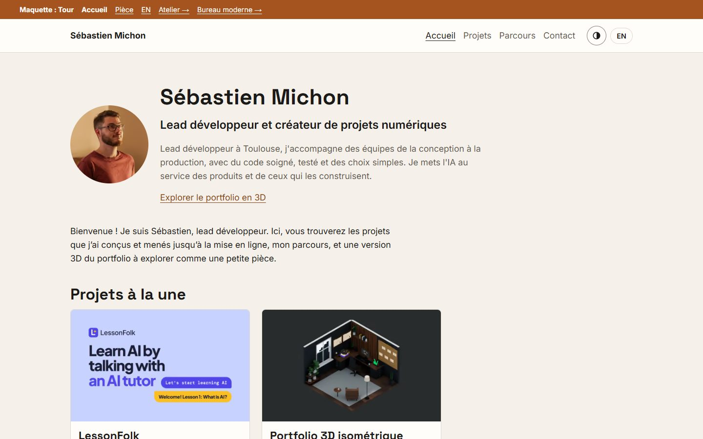 |
| Accueil, sombre |  |  | 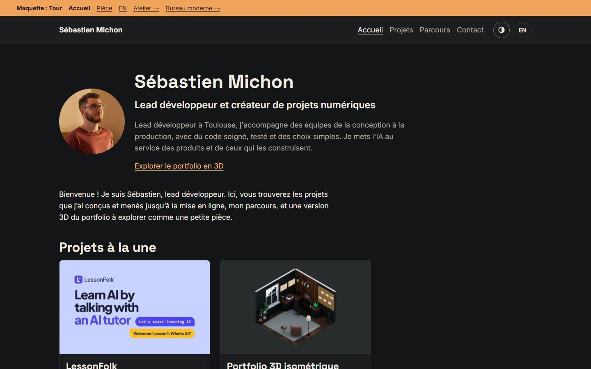 |
| Pièce, jour |  |  | 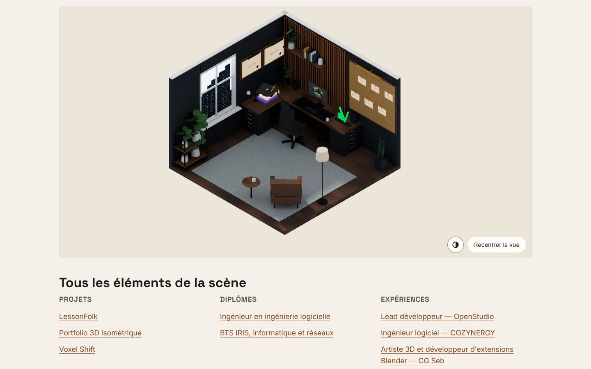 |
| Pièce, nuit |  |  | 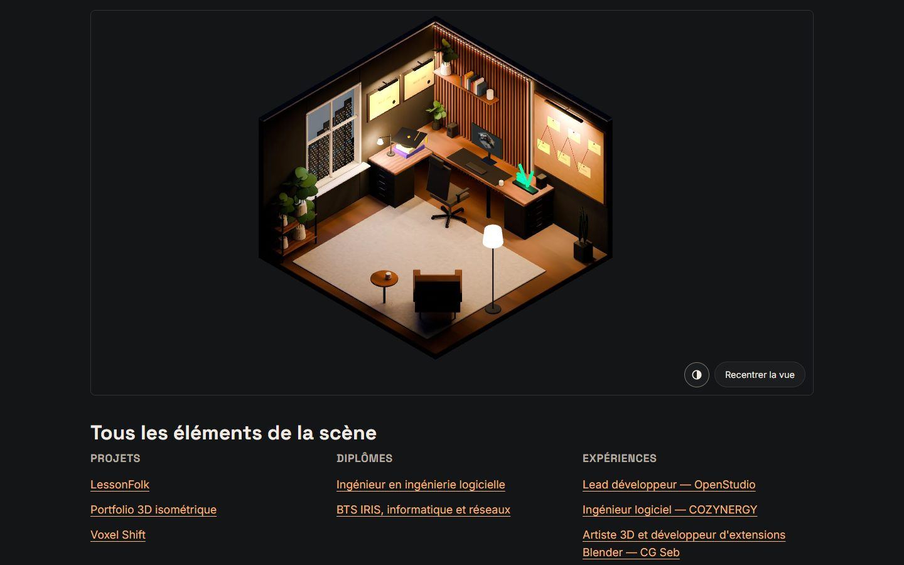 |
| Panneau, jour | 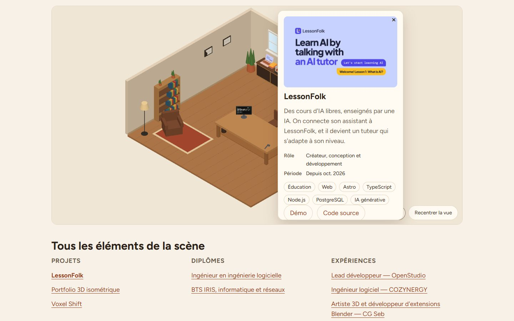 |  | 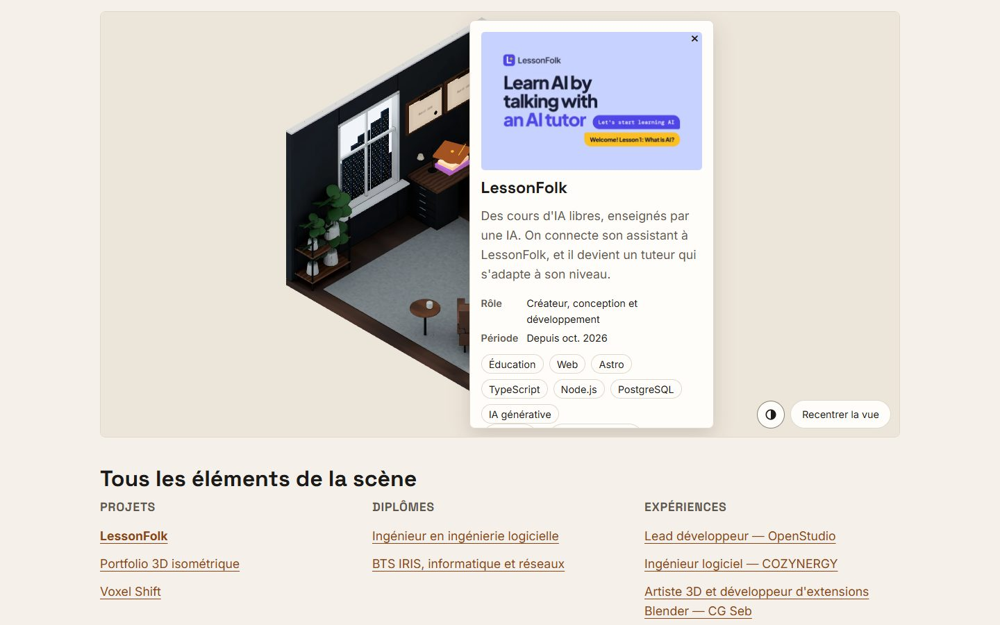 |
| Panneau, nuit | 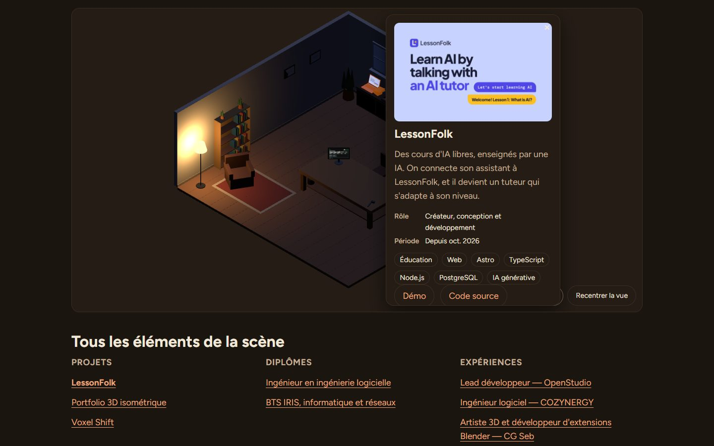 | 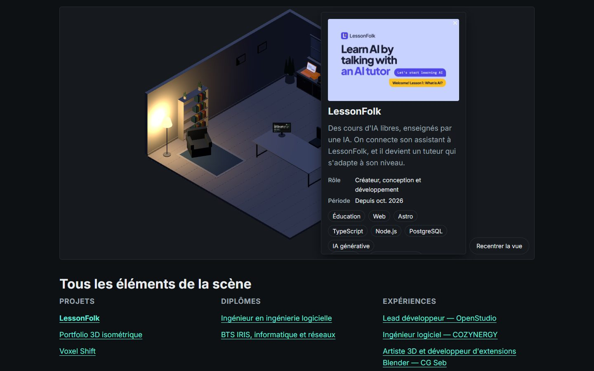 | 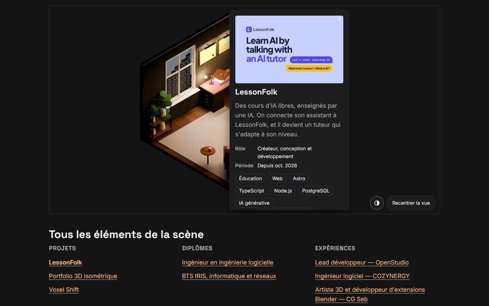 |

## Téléphone (375 px)

| | Atelier | Bureau moderne | Tour |
|---|---|---|---|
| Accueil, clair |  |  | 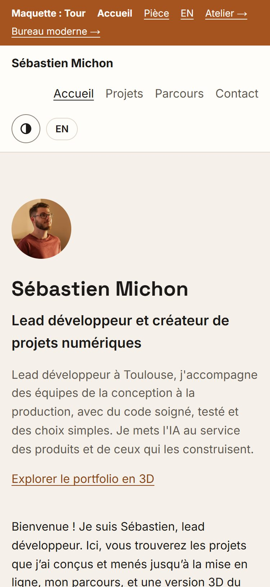 |
| Accueil, sombre |  |  | 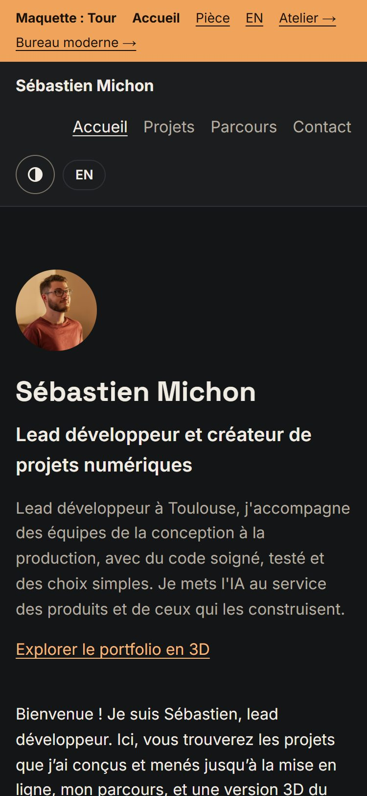 |
| Pièce, jour |  |  | 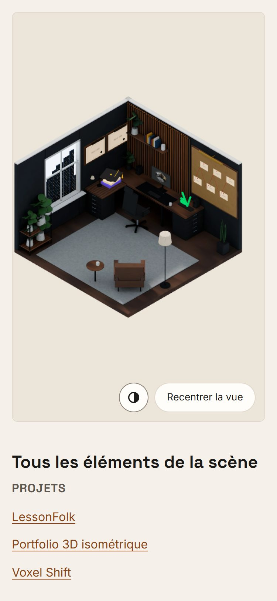 |
| Pièce, nuit |  |  | 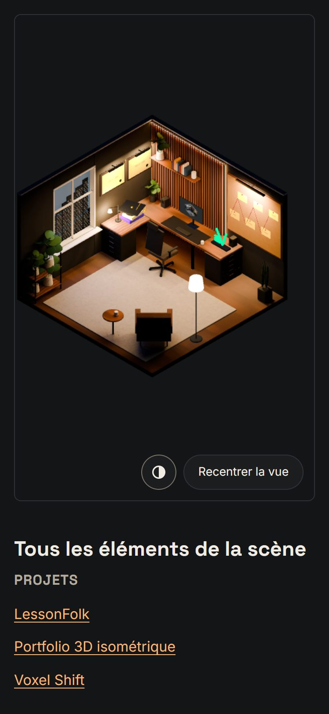 |

## Ce qui distingue les trois styles

| | Atelier | Bureau moderne | Tour |
|---|---|---|---|
| Ambiance | chaleureuse : bois, sable, crème | épurée : blanc, gris clair, graphite | bureau chaleureux en haut d'un immeuble : murs anthracite, noyer, lin |
| Accent | terracotta | sarcelle | ambre, comme les LED (focus sarcelle) |
| Police | Figtree (plus ronde) | Inter (celle d'aujourd'hui) | Space Grotesk pour les titres, Inter pour le texte |
| Arrondis | larges (1 rem) | fins (0,375 rem) | moyens (0,5 rem) |
| Pièce | parquet, établi en bois, outils | parquet clair, bureau blanc à plateau fin | petite pièce aménagée : bureau en L en noyer avec caissons noirs ; sur le bureau, un chapeau de diplômé pour LessonFolk (à gauche), l'écran principal qui montre le portfolio (devant le fauteuil) et le logo vert de Voxel Shift (à droite) ; deux grands cadres de diplômes sous leurs lampes de tableau ; les expériences en frise sur un grand tableau en liège, reliées par un fil rouge ; mur de lattes de bois éclairé, étagères avec plantes et livres, fenêtre sur la ville, étagère à plantes, grand tapis, fauteuil en cuir, lampadaire ; lumière précalculée (ombres douces, veinage) |
| Nuit | bruns chauds sous la lampe | graphite et lumière froide | ville allumée par la fenêtre, bandeau LED ambré derrière les lattes, lampes de tableau sur les diplômes et le tableau des expériences, logo de Voxel Shift lumineux, lampe de bureau, lampadaire |
