# Captures des maquettes

Prises le 31/10/2026 avec le contenu réel, sur `npm run dev` (`/_maquettes/<style>/`).
Animations réduites : la pièce s'affiche directement. Sur ordinateur, le panneau d'un projet est
ouvert ; sur téléphone, la pièce est seule (le panneau la recouvrirait en entier).

Nom : `<style>-<thème>-<largeur>-<écran>.jpg`.

## Ordinateur (1440 px)

| | Atelier | Bureau moderne |
|---|---|---|
| Accueil, clair | 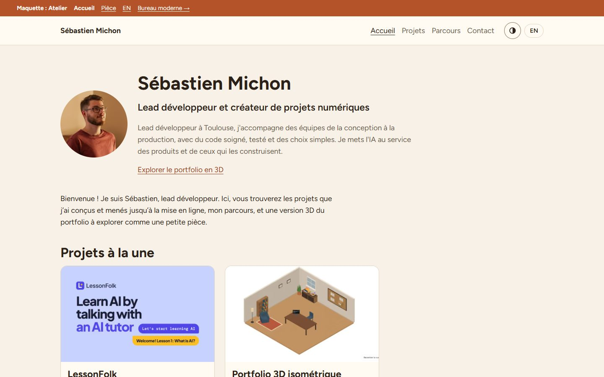 | 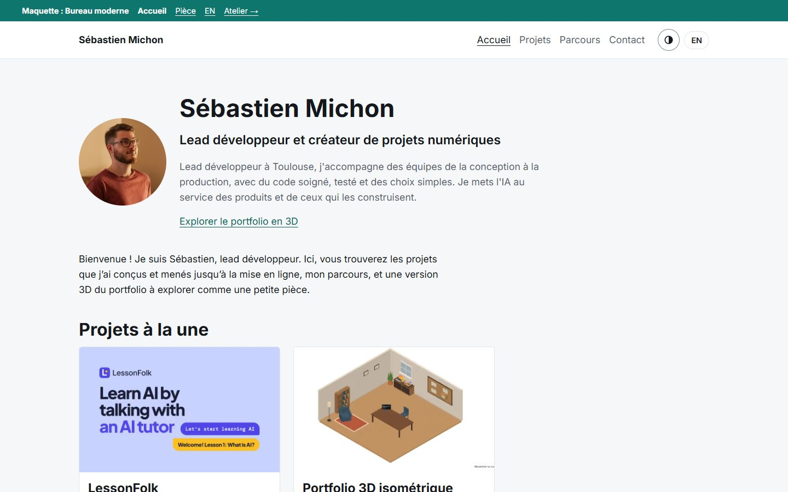 |
| Accueil, sombre | 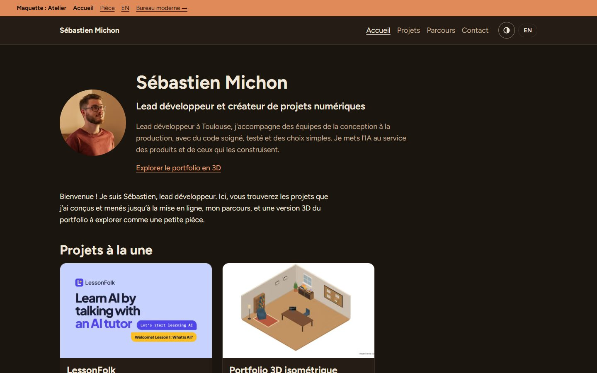 | 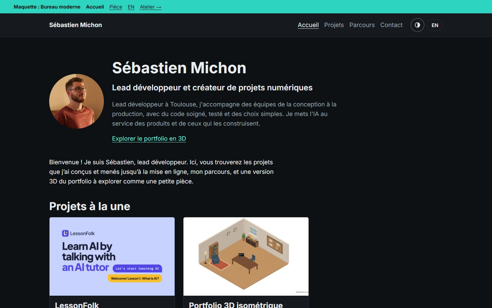 |
| Pièce, jour | 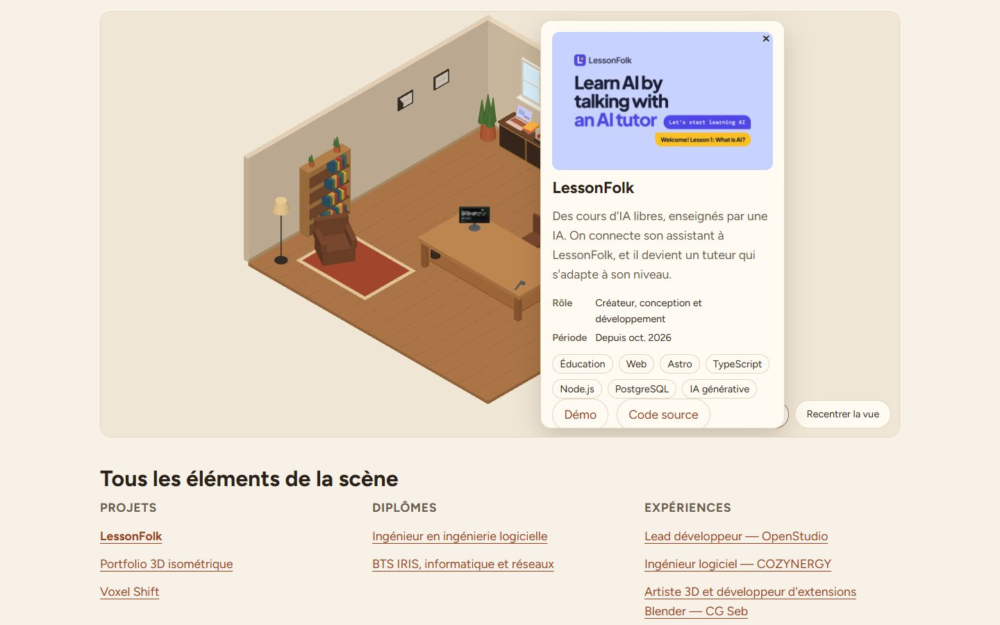 | 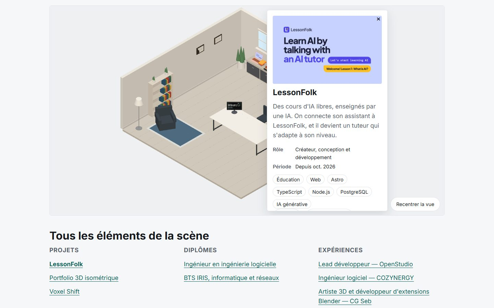 |
| Pièce, nuit | 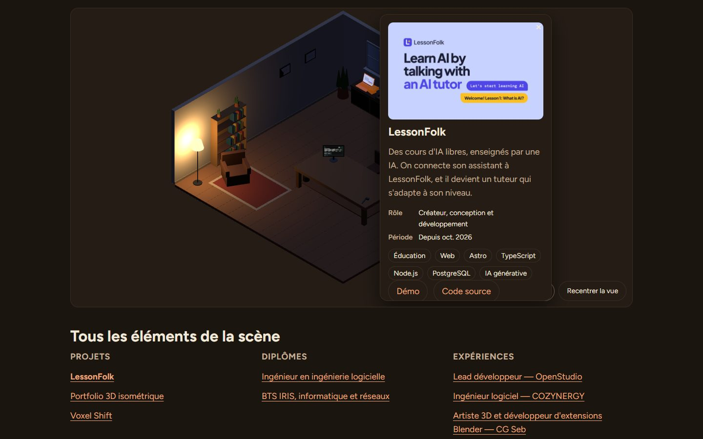 | 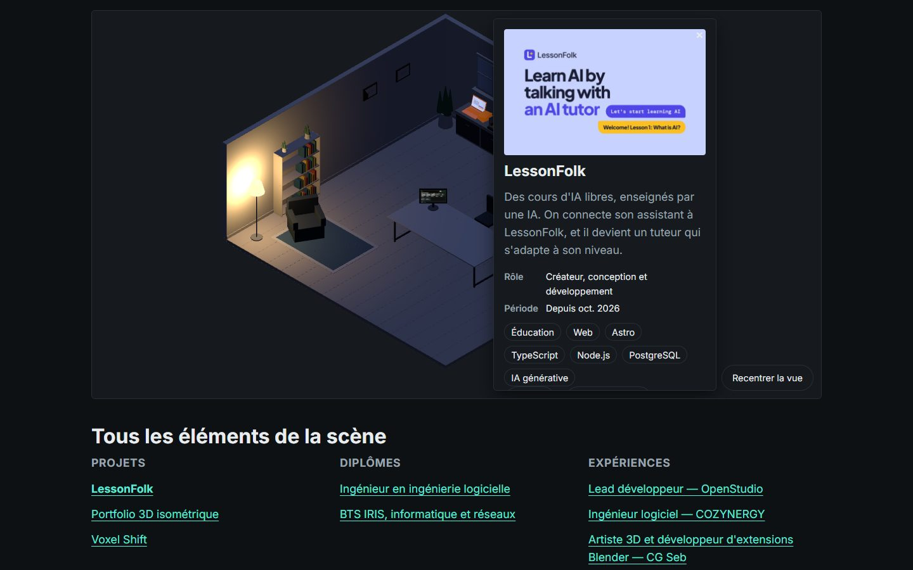 |

## Téléphone (375 px)

| | Atelier | Bureau moderne |
|---|---|---|
| Accueil, clair | 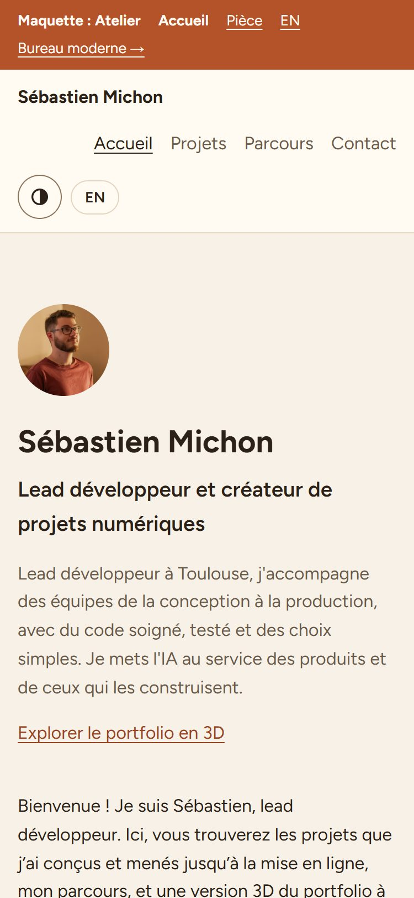 | 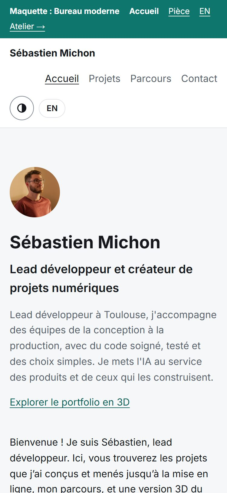 |
| Accueil, sombre | 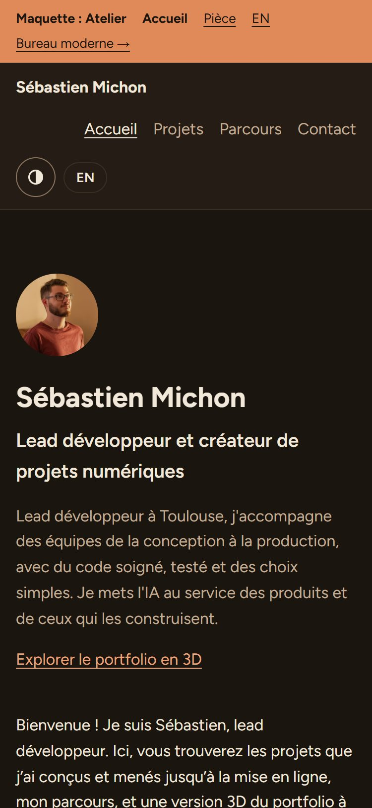 | 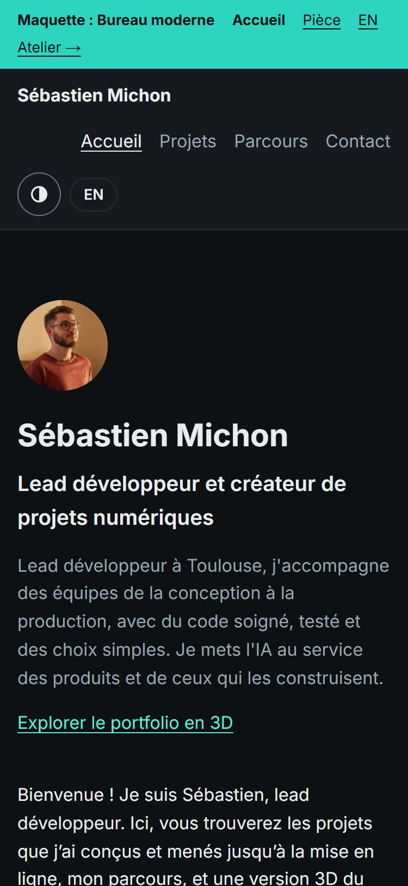 |
| Pièce, jour | 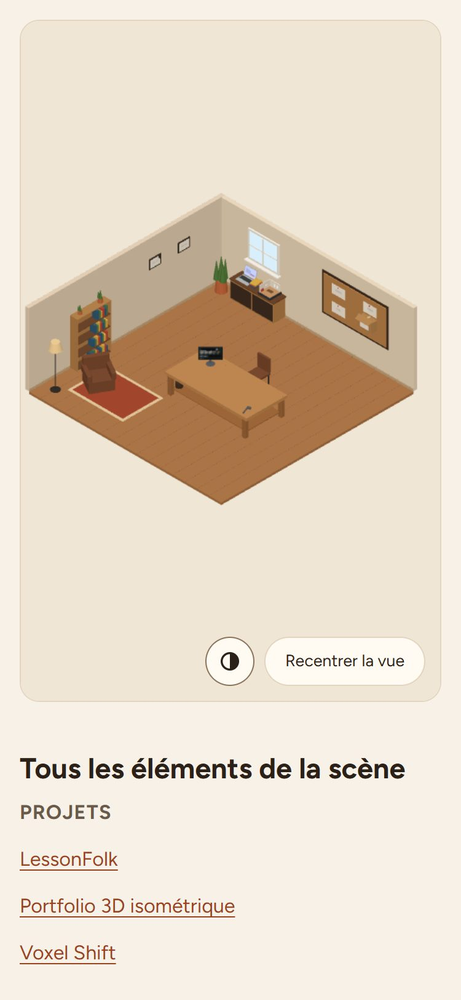 | 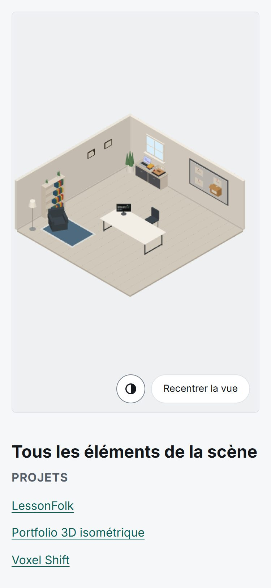 |
| Pièce, nuit | 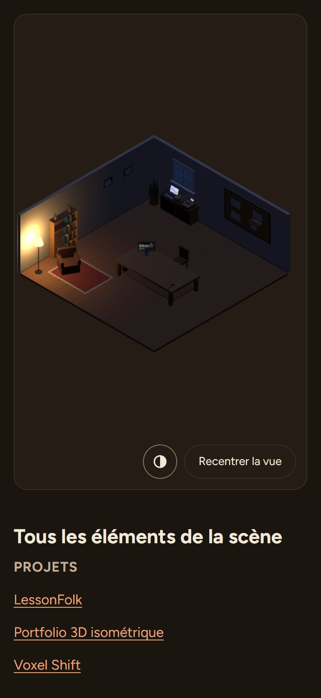 | 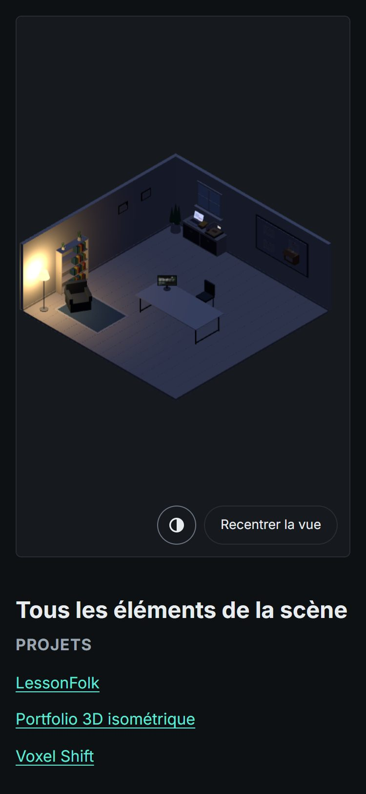 |

## Ce qui distingue les deux styles

| | Atelier | Bureau moderne |
|---|---|---|
| Ambiance | chaleureuse : bois, sable, crème | épurée : blanc, gris clair, graphite |
| Accent | terracotta | sarcelle |
| Police | Figtree (plus ronde) | Inter (celle d'aujourd'hui) |
| Arrondis | larges (1 rem) | fins (0,375 rem) |
| Support des projets | établi en bois, étagère basse, outils | bureau blanc à plateau fin, pieds noirs |
| Nuit | bruns chauds sous la lampe | graphite et lumière froide |
