# Rendus de la figurine

Rendus pour la validation de la ressemblance (T008). Ils se régénèrent avec :

```bash
blender --background --python assets-src/models/build_models.py -- --only avatar
```

```bash
blender --background --python assets-src/models/render_avatar.py
```

Dans ces rendus, la pièce est `room.blend` avec ses textures précalculées, comme dans la scène. Les objets posés
(écrans, diplômes, fiches) n'y figurent pas. L'ombre de la figurine vient du précalcul.

## La photo et la tête

| Photo | Rendus |
|---|---|
|  | 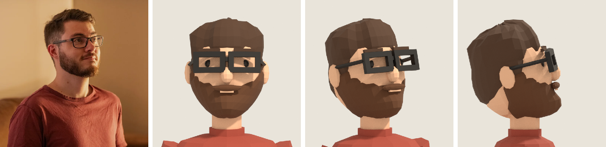 |

## Le corps

Face, trois-quarts et angle de la scène :

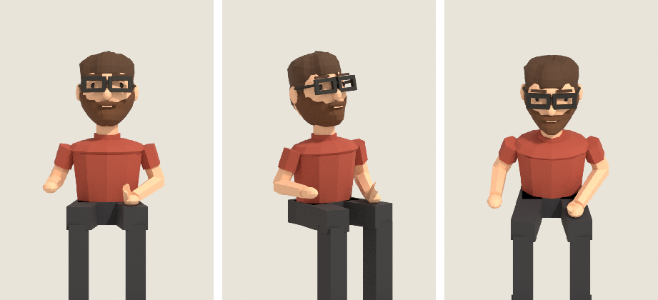

## Dans la pièce

| Téléphone, jour | Téléphone, nuit |
|---|---|
| 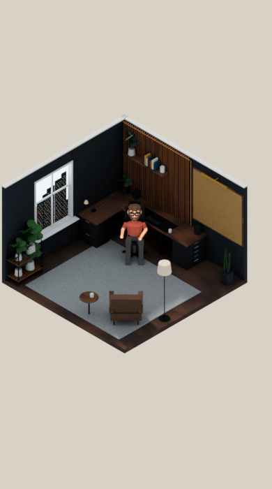 | 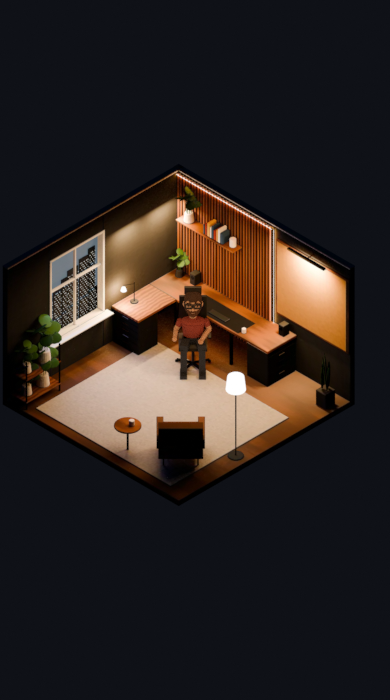 |

Ordinateur, jour et nuit :

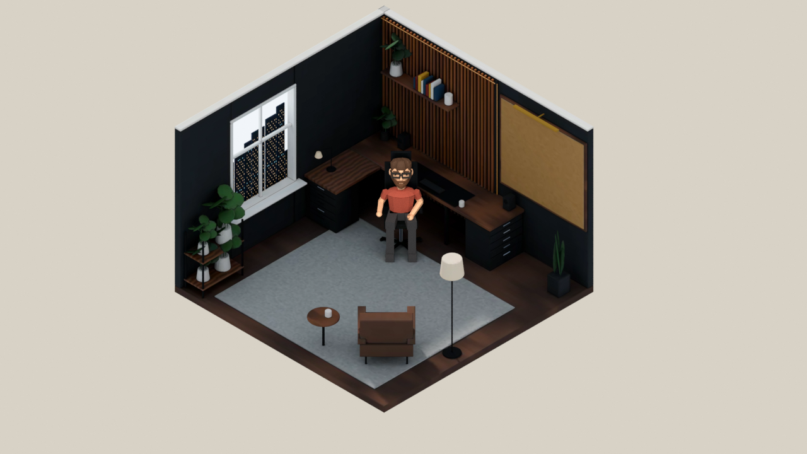

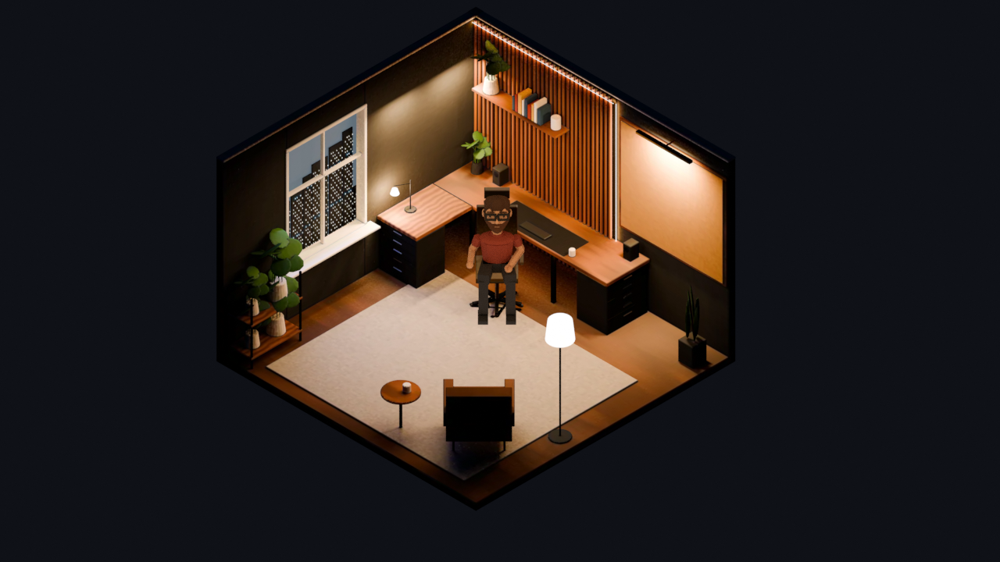

## La chaise et le bureau

Dessus, depuis l'est et depuis le sud :

| Dessus | Est | Sud |
|---|---|---|
| 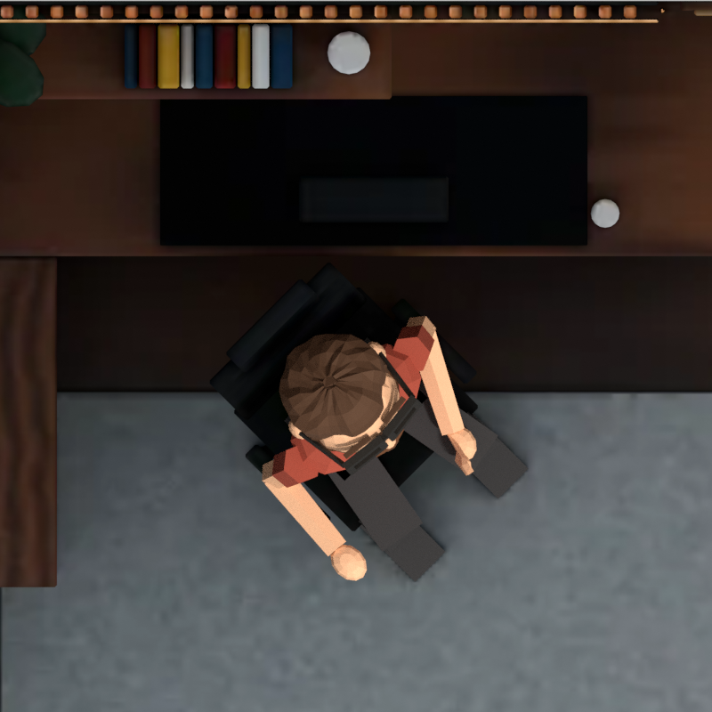 | 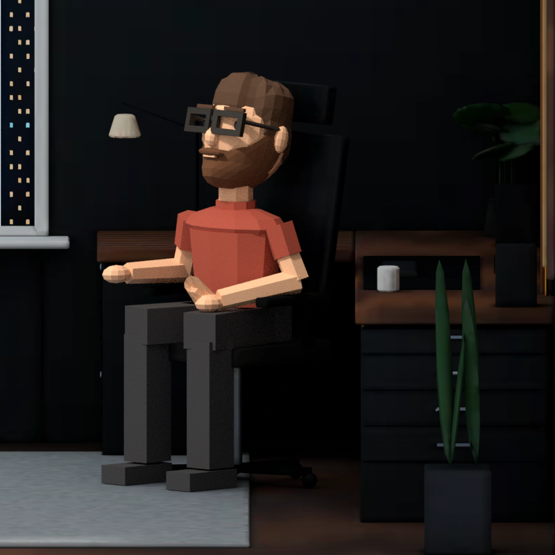 | 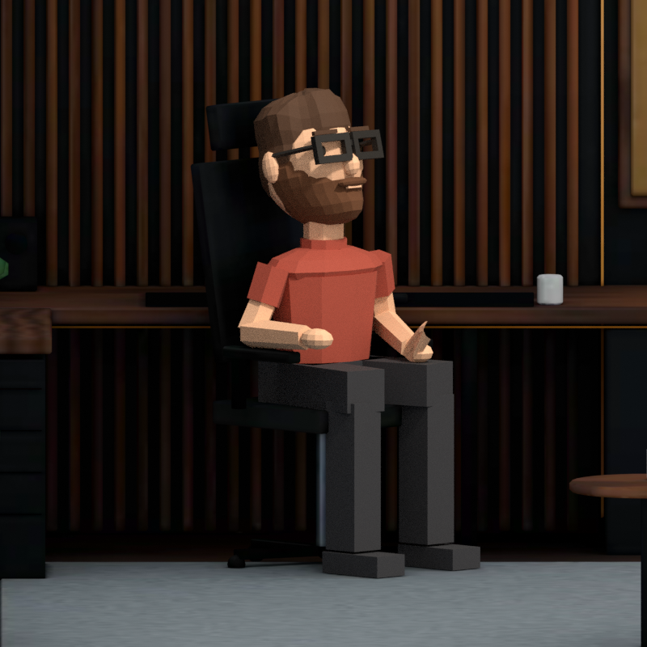 |

## À la taille réelle d'un téléphone

Environ 58 px par mètre, la tête fait une vingtaine de pixels de large. Le recadrage est à sa taille réelle, puis agrandi
cinq fois sans lissage.

| Jour | Nuit |
|---|---|
|  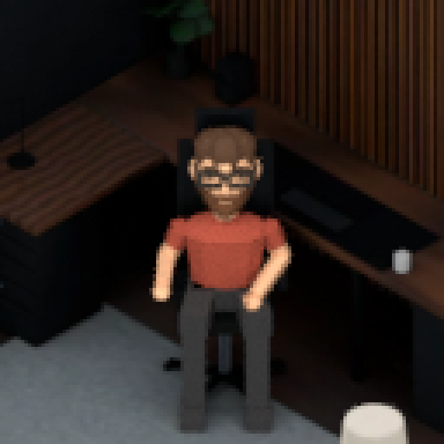 | 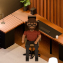 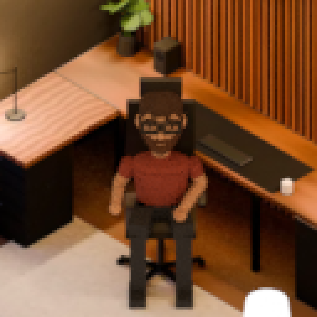 |

## Le bras levé

Contrôle du pivot `avatar.arm` à l'épaule (axe et angle : `RAISED` dans `render_avatar.py`) :

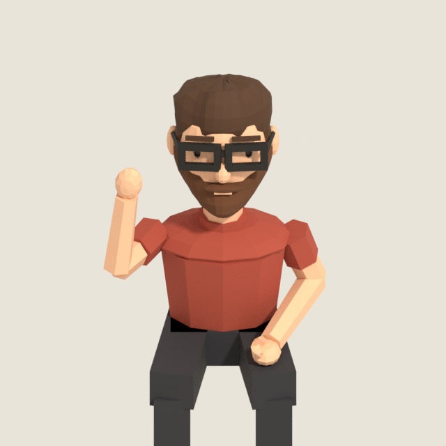

## Sur le vrai site

Captures du site lui-même, avec un rendu logiciel (SwiftShader).

| Jour | Nuit |
|---|---|
| 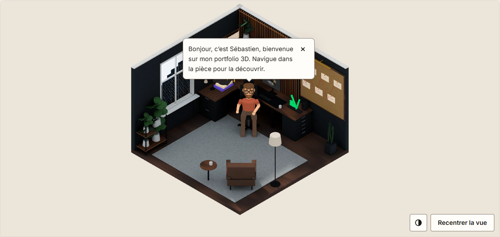 | 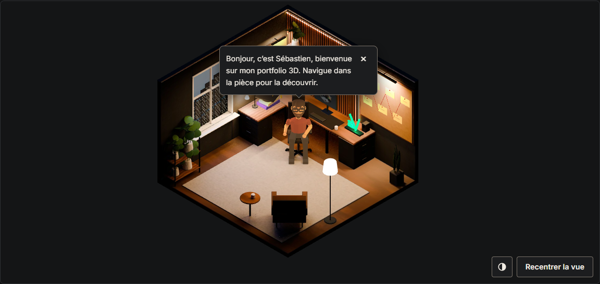 |
| 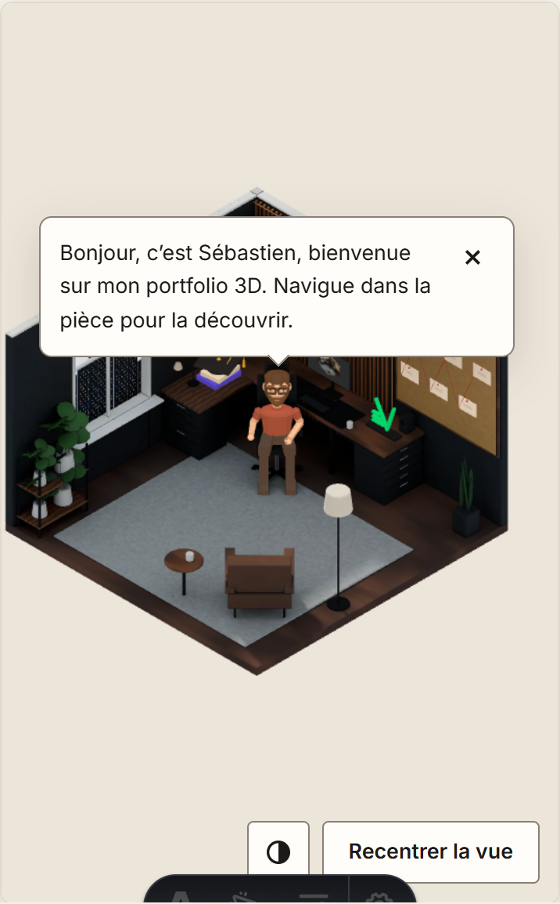 | 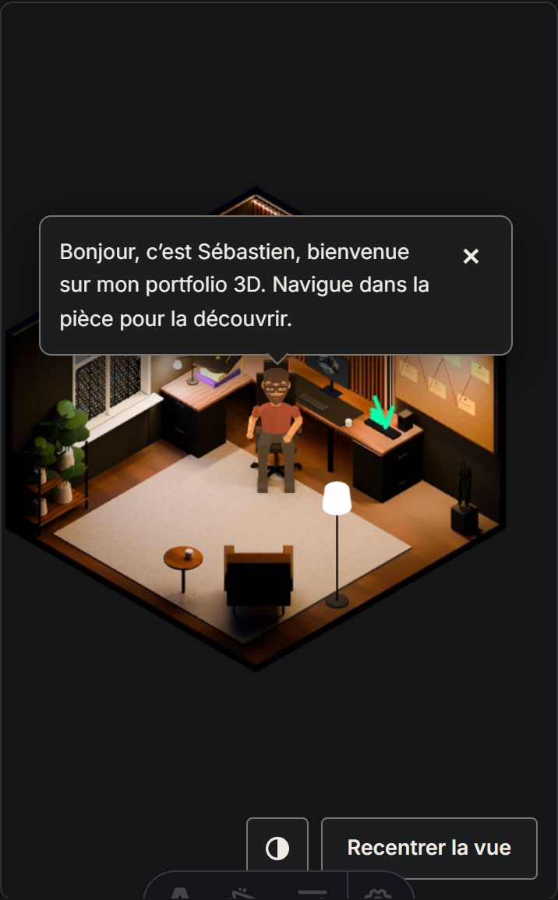 |
| 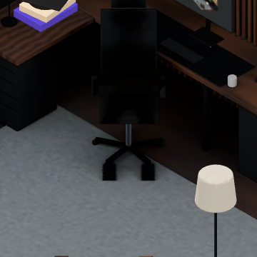 | 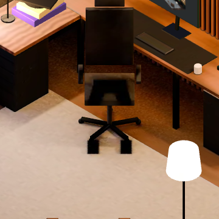 |

La dernière ligne montre la chaise quand `avatar.glb` ne se charge pas (scénario 18).

La main levée pendant le salut :

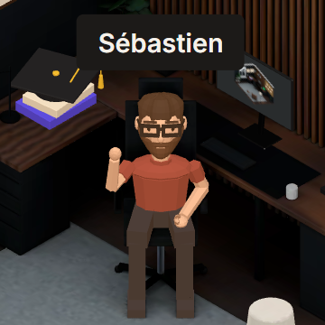
